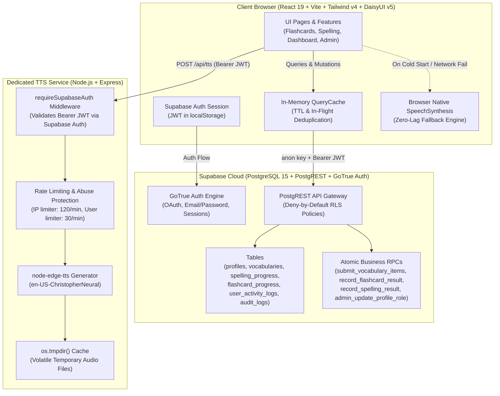

# Imlaa Architecture & Data Contract Guide

> Technical reference detailing the target architecture, security model, data flows, and performance guarantees of the Imlaa platform.

---

## 1. System Topology & Target Architecture

Imlaa operates under a **unified single-data-pipeline architecture**. Direct Supabase PostgREST calls with Row-Level Security (RLS) govern all application data and authentication, while a minimal, hardened Express service handles server-side Microsoft Neural Text-to-Speech (TTS) synthesis.



---

## 2. Data Flow Principles

### 2.1 Browser -> Supabase (Primary CRUD & RPC)
- **Zero Intermediary Server for Data**: The frontend communicates directly with Supabase via `@supabase/supabase-js` using the **public anon key**.
- **No Client-Side Business Invariants**: Complex operations that mutate multiple tables or require atomic transactions are executed via Postgres RPCs with `SECURITY DEFINER` semantics:
  - `submit_vocabulary_items`: Parses, dedupes, and commits vocabulary words and audit log entries in a single transaction.
  - `record_flashcard_result`: Atomically shifts words between `known_words`, `unknown_words`, and `forgot_words` sets.
  - `record_spelling_result`: Atomically adds mastered or incorrect words to `spelling_progress`.
  - `admin_update_profile_role`: Verifies the caller is an admin and updates the candidate's role.
  - `get_vocabulary_topic_counts`: Fast grouping of active, listening, and uploaded lexemes directly inside the database.

### 2.2 Browser -> Express (TTS Microservice Only)
- The Express service (`server/index.js`) **only** exposes `GET /health` and `POST /api/tts`.
- There are no Express CRUD, user, access-ID, or database routes.
- Calls to `POST /api/tts` require an `Authorization: Bearer <access_token>` header containing a valid Supabase Auth JWT.
- If the TTS server is in cold-start or unreachable ($> 2.8\text{s}$), the frontend seamlessly falls back to the browser's native `window.speechSynthesis` so the candidate is never blocked.

---

## 3. Directory Structure & God Module Decomposition

The codebase is split into domain-specific modules adhering to the $\le 300\text{--}400$ lines per file guideline:

```
project-ilmaa/
├── src/
│   ├── auth/                    # Focused Authentication Modules
│   │   ├── AuthProvider.jsx     # Root Auth Context Provider
│   │   ├── useSession.js        # Supabase session lifecycle & refresh
│   │   ├── useProfile.js        # Profile loader & presence sync
│   │   ├── usePasswordReset.js  # Password reset flow
│   │   ├── useOtp.js            # OTP verification
│   │   ├── useAccountActions.js # Sign out, role change triggers
│   │   └── permissions.js       # Role constants (ADMIN, GENERAL)
│   ├── features/                # Domain-Specific UI Components
│   │   └── admin/
│   │       ├── UserDirectory.jsx   # Candidate directory with pagination & search
│   │       ├── UserInspector.jsx   # Candidate deep drilldown modal
│   │       ├── AuditLogTable.jsx   # Security audit trail with pagination
│   │       └── RoleChangeDialog.jsx# Secure confirmation dialog for admin promotions
│   ├── services/                # Decoupled Domain Services
│   │   ├── supabaseClient.js    # Shared Supabase browser instance
│   │   ├── queryCache.js        # In-memory TTL cache & deduplication
│   │   ├── vocabularyService.js # Vocabulary CRUD, RPCs & stats
│   │   ├── progressService.js   # Flashcard, spelling, and grammar progress
│   │   ├── adminService.js      # Candidate directory, presence, and profile metrics
│   │   ├── auditService.js      # Security and access event logging & deletions
│   │   ├── grammarService.js    # Interactive grammar questions & rules
│   │   ├── studySessionService.js# Study session duration tracker
│   │   ├── dataMappers.js       # Snake_case <-> camelCase bidirectional mappers
│   │   └── apiClient.js         # Backward-compatible facade delegating to services
│   ├── hooks/                   # Reusable Interactive Hooks
│   │   ├── useCountdownTimer.js # Modal and quiz timer
│   │   ├── useModalEffects.js   # Body scroll lock & ESC key handling
│   │   └── useKeyboardNavigation.js# Arrow keys and flip shortcuts
│   └── utils/
│       ├── escapeHtml.js        # Untrusted content escaping for print/PDF
│       ├── sweetalert.js        # DaisyUI/Tailwind styled alert & toast triggers
│       └── speechTts.js         # Unified TTS dispatcher with instant fallback
├── database/                    # Versioned Database Migrations
│   ├── schema.sql               # Base idempotent schema
│   ├── security_policies.sql    # Deny-by-default RLS policies
│   └── migrations/              # Incremental numbered migrations
└── docs/
    └── architecture.md          # System architecture specification
```

---

## 4. Security & Access Control Model

### 4.1 Row-Level Security (RLS) Contract
All public tables have RLS enabled with a strict **Deny-by-Default** posture:
- **`profiles`**:
  - `SELECT`: Signed-in users can view profiles.
  - `UPDATE`: `auth.uid() = id`.
  - Direct column modification of `role` is blocked; role elevation requires `admin_update_profile_role` RPC.
- **`spelling_progress` / `flashcard_progress` / `grammar_progress` / `user_activity_logs`**:
  - `ALL`: Restricted strictly to `auth.uid() = user_id`.
- **`vocabularies`**:
  - `SELECT`: All authenticated candidates can read curriculum topics; uploaded topics are filtered to the owner or admin.
  - `INSERT` / `UPDATE` / `DELETE`: Governed by ownership check (`uploaded_by_id = auth.uid()`) or admin status.
- **`audit_logs`**:
  - Append-only via trusted server RPC or authenticated client action logging. Client update is denied; deletion is restricted to platform administrators.

### 4.2 Credential Isolation
- **No Service Role Key in Frontend**: The frontend bundle **only** receives `VITE_SUPABASE_ANON_KEY`.
- **Secret Scanner**: An automated script (`scripts/scan-secrets.mjs`) runs in CI to verify that no high-entropy credentials or service-role keys are committed.
- **Content Security**: All dynamically rendered strings interpolated into HTML print frames (e.g. `exportReportPdf.js`) pass through `escapeHtml()` to eliminate XSS vectors.

---

## 5. Caching & Performance Architecture

### 5.1 Service Worker Boundary (`public/sw.js` v2)
- Caching is strictly scoped to static assets (`.js`, `.css`, fonts, icons) and bounded audio assets.
- **Explicit Exclusion**: All queries to `*.supabase.co`, authentication endpoints, and external APIs (ImgBB, EmailJS) bypass the service worker completely.
- **Bounded Audio Storage**: The audio cache holds a maximum of 150 items with automated FIFO eviction.

### 5.2 In-Memory Query Cache (`src/services/queryCache.js`)
- **Request Deduplication**: Simultaneous components requesting the same dataset share a single in-flight promise.
- **Configurable TTL**:
  - Vocabulary Stats: 45 seconds TTL
  - Admin Directory: 30 seconds TTL
  - Security Audit Logs: 20 seconds TTL
- **Mutation Invalidation**: Calling `createVocabulary`, `deleteVocabulary`, or `updateUserRole` automatically invalidates the respective cache keys.

### 5.3 Pagination Standard
All tabular interfaces (`UserDirectory.jsx`, `AuditLogTable.jsx`, `VocabMonitorPage.jsx`) enforce pagination with a maximum of 15–25 items per page and mobile-friendly touch targets ($\ge 44\text{px}$).

### 5.4 Vendor Chunk Splitting (`vite.config.js`)
- `vendor-react`: `react`, `react-dom`, `react-router` (~294 kB)
- `vendor-supabase`: `@supabase/supabase-js` (~214 kB)
- `vendor-ui`: `sweetalert2`, `@emailjs/browser` (~81 kB)
- Core App Bundle: ~40 kB

---

## 6. Environment Variables Reference

### Frontend (`project-ilmaa/.env.example`)
| Variable | Description | Default / Example |
|---|---|---|
| `VITE_SUPABASE_URL` | Supabase Cloud project URL | `https://your-project.supabase.co` |
| `VITE_SUPABASE_ANON_KEY` | Supabase public anonymous API key | `your-anon-key` |
| `VITE_BACKEND_URL` | Dedicated Express TTS service endpoint | `http://localhost:5000` |
| `VITE_FRONTEND_URL` | Local client URL | `http://localhost:5173` |
| `VITE_EMAILJS_SERVICE_ID` | Optional EmailJS service ID | `service_ilmaa` |
| `VITE_EMAILJS_TEMPLATE_ID`| Optional EmailJS template ID | `template_ilmaa` |
| `VITE_EMAILJS_PUBLIC_KEY` | Optional EmailJS public key | `your-public-key` |
| `VITE_IMAGEBB_KEY` | Optional ImgBB API key for avatars | `your-imgbb-api-key` |

### Backend (`server/.env.example`)
| Variable | Description | Default / Example |
|---|---|---|
| `PORT` | Listening HTTP port | `5000` |
| `NODE_ENV` | Environment mode (`development` / `production`)| `development` |
| `SUPABASE_URL` | Supabase Cloud project URL | `https://your-project.supabase.co` |
| `SUPABASE_ANON_KEY` | Supabase public anonymous API key (JWT validation) | `your-anon-key` |
| `CORS_ORIGINS` | Comma-delimited list of allowed origin URLs | `http://localhost:5173,https://your-app.example` |
